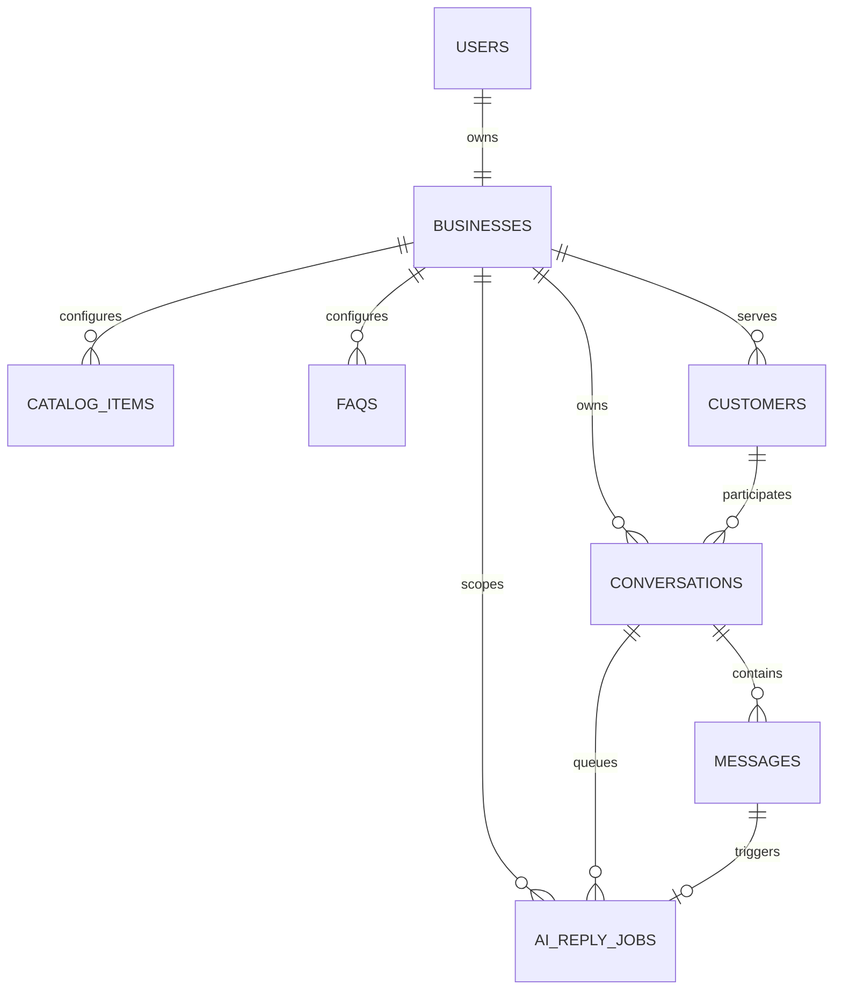

# Database Design

## Status

This document distinguishes implemented models and behavior from future work. The backend contains Mongoose models and indexes for `users`, `businesses`, `catalogItems`, `faqs`, `customers`, `conversations`, `messages`, and `aiReplyJobs`, plus a MongoDB connection configured to select `whatsapp_sales_assistant`. The connection code does not establish whether Atlas is reachable in a particular environment. Incoming text webhook processing, outbound Cloud API calls, webhook-driven outgoing message status updates, and a disabled-by-default draft-generation worker are implemented. Incoming webhooks do not enqueue AI jobs; the worker does not send replies. Delivery-driven UI refresh remains future behavior. Field types use MongoDB/Mongoose conventions (`ObjectId`, `String`, `Date`, `Boolean`, `Number`, and embedded objects).

## Collections and fields

### `users`

| Field | Type | Notes |
|---|---|---|
| `_id` | ObjectId | Primary identifier. |
| `name` | String | Required display name. |
| `email` | String | Required, normalized lowercase; unique. |
| `passwordHash` | String | bcrypt hash only. |
| `businessId` | ObjectId | Required reference to the user's one business. |
| `role` | String | `owner` for MVP; allows future operator roles without shipping them now. |
| `createdAt`, `updatedAt` | Date | Timestamps. |

### `businesses`

| Field | Type | Notes |
|---|---|---|
| `_id` | ObjectId | Workspace identifier. |
| `ownerUserId` | ObjectId | Required reference to the sole owner in Version 1.0. |
| `name` | String | Required business display name. |
| `description` | String | Optional factual business description. |
| `industry` | String | Optional category. |
| `contactDetails` | Object | Optional owner-configured public details; current profile API supports phone, email, website, and address. |
| `timezone` | String | Optional IANA timezone for display. |
| `whatsapp` | Object | One `phoneNumberId`, display number, `connectionStatus`, and credential reference/metadata. Current UI states are `not_configured` and `configured_not_verified`; a saved ID alone is not a verified Meta connection. Never plaintext tokens. |
| `aiSettings` | Object | `enabledByDefault`, model identifier/configuration, context-message limit, and communication preferences. No secrets. |
| `createdAt`, `updatedAt` | Date | Timestamps. |

MVP relationship: each owner has exactly one business, and each business has exactly one owner. Enforce uniqueness of `businesses.ownerUserId` and of `users.businessId` (required). Adding operators later may change the one-to-many user relationship.

### `catalogItems`

Products and services share this collection, distinguished by `kind`.

| Field | Type | Notes |
|---|---|---|
| `_id` | ObjectId | Identifier. |
| `businessId` | ObjectId | Required business reference. |
| `kind` | String | `product` or `service`. |
| `name` | String | Required. |
| `description` | String | Optional factual details. |
| `priceInPaise` | Number | Optional integer minor units for INR; do not use floating-point monetary arithmetic. |
| `currency` | String | Required and constrained to `INR` by the current model; defaults to `INR`, including when no price is supplied. |
| `availability` | String | Optional owner-maintained availability statement; do not infer live stock from stale text. |
| `isActive` | Boolean | Whether it may be included in AI context. |
| `createdAt`, `updatedAt` | Date | Timestamps. |

Example: `priceInPaise: 45000`, `currency: "INR"` represents ₹450. Display conversion divides the integer paise by 100 and formats it for the selected currency/locale. Persist and calculate using integer minor units only; do not calculate money using floating-point values.

### `faqs`

| Field | Type | Notes |
|---|---|---|
| `_id` | ObjectId | Identifier. |
| `businessId` | ObjectId | Required business reference. |
| `question` | String | Required. |
| `answer` | String | Required owner-provided source of truth. |
| `isActive` | Boolean | Whether it may be included in AI context. |
| `createdAt`, `updatedAt` | Date | Timestamps. |

### `customers`

| Field | Type | Notes |
|---|---|---|
| `_id` | ObjectId | Identifier. |
| `businessId` | ObjectId | Required business reference. |
| `phoneNumber` | String | Required normalized international number, stored as digits without a leading `+`. |
| `profileName` | String | Optional provider profile name, limited to 100 characters. |
| `createdAt`, `updatedAt` | Date | Timestamps. |

The model enforces uniqueness of `{ businessId, phoneNumber }` and validates the normalized number format. Store only the phone number and optional provider display name needed for the MVP.

### `conversations`

| Field | Type | Notes |
|---|---|---|
| `_id` | ObjectId | Identifier. |
| `businessId` | ObjectId | Required business reference. |
| `customerId` | ObjectId | Required reference to a customer in the same business. |
| `status` | String | Required `open` or `closed`; defaults to `open`. |
| `responseMode` | String | `human` or `ai`; defaults to `human`. `ai` permits draft generation only when the worker is enabled; it does not authorize sending. |
| `aiControlVersion` | Number | Internal non-negative integer write fence. Draft completion and human takeover increment it on this same document to serialize their transactions/updates. It is not an owner-facing field. |
| `lastMessageAt` | Date | Optional timestamp used for conversation ordering. |
| `lastMessagePreview` | String | Optional trimmed preview, limited to 280 characters. |
| `createdAt`, `updatedAt` | Date | Timestamps. |

The model enforces one conversation per `{ businessId, customerId }`. Response mode is checked by the draft worker before generation and immediately before draft persistence. Channel and dispatch state are not part of this model.

### `messages`

| Field | Type | Notes |
|---|---|---|
| `_id` | ObjectId | Identifier. |
| `businessId` | ObjectId | Required for tenant-scoped queries and indexes. |
| `conversationId` | ObjectId | Required reference to a conversation in the same business. |
| `customerId` | ObjectId | Required reference to the customer associated with the conversation. |
| `direction` | String | Required `inbound` or `outbound`. |
| `messageType` | String | Required; currently `text` only. |
| `text` | String | Required trimmed text, 1–4096 characters. Subject to an approved retention policy. |
| `providerMessageId` | String | Optional provider ID, trimmed and limited to 256 characters. A partial unique index deduplicates non-empty IDs per business. |
| `status` | String | Required enum: `received`, `sent`, `delivered`, `read`, or `failed`. Verified provider status callbacks update outgoing message status. |
| `timestamp` | Date | Optional provider message timestamp when available; status processing does not overwrite it. |
| `providerStatusAt` | Date | Optional timestamp of the latest accepted provider delivery/read status event, separate from message `timestamp` and Mongoose creation time. |
| `providerErrorCode` | String | Optional failure code, bounded to 64 characters. |
| `providerErrorTitle` | String | Optional provider failure title, bounded to 200 characters. Arbitrary provider error payloads are not stored. |
| `createdAt`, `updatedAt` | Date | Timestamps. |

Outbound records may be created without a provider message ID; the ID is optional and must only be stored when supplied by the provider. No access tokens or other credentials are stored in message documents. Webhook status processing matches only outgoing messages by business and provider ID. Successful statuses advance `sent` → `delivered` → `read`; older events do not regress state. At equal timestamps, the forward successful progression wins, while `failed` can replace `sent` but does not replace `delivered` or `read`. A recorded `failed` status is terminal. Duplicate or non-advancing events do not rewrite the message. Failure code/title are stored only when available and within the field limits. Delivery status is not a retry/send queue and does not automatically alter provider sends.

### `aiReplyJobs`

This internal collection stores durable owner-review draft work. Webhook ingestion does not enqueue jobs yet, and a `draft_ready` job is not a sent message.

| Field | Type | Notes |
|---|---|---|
| `_id` | ObjectId | Job identifier. |
| `businessId` | ObjectId | Required business scope. |
| `conversationId` | ObjectId | Required reference to the conversation. |
| `inboundMessageId` | ObjectId | Required triggering inbound message; unique per business/job. |
| `status` | String | `queued`, `processing`, `draft_ready`, `failed`, or `cancelled`. |
| `attemptCount` | Number | Non-negative safe integer used as a completion fencing token; at most three attempts are claimed. |
| `nextAttemptAt` | Date | Earliest eligible retry/claim time. |
| `lockedAt`, `leaseExpiresAt` | Date | Optional processing lease fields. |
| `generatedDraft` | String | Optional bounded draft (maximum 4096 characters) for owner review only. |
| `errorCode` | String | Optional safe category such as `context_unavailable`, `provider_timeout`, `database_unavailable`, or `invalid_output`; no raw provider/database errors. |
| `createdAt`, `updatedAt` | Date | Timestamps. |

The worker uses atomic claims and attempt/lease-fenced retry, failure, cancellation, and draft-completion transitions. It does not create an outbound `Message` or call WhatsApp.

## Relationships



All records owned by a business (`catalogItems`, `faqs`, `customers`, `conversations`, `messages`, and `aiReplyJobs`) contain `businessId`. The owner/business relationship is one-to-one in the MVP; future operators are not part of current scope. Mongoose `ref` declarations describe ObjectId relationships but do not enforce that referenced records exist or belong to the same business. Services must validate those relationships and scope all reads/writes using authenticated, verified, or trusted persisted job ownership.

## Conversation reuse and lifecycle

The current MVP model allows one conversation per customer per business and enforces it with a unique `{ businessId, customerId }` index. A closed conversation therefore remains the customer's conversation; opening a new conversation for the same customer would require a deliberate schema/index and lifecycle change. Incoming text webhook processing creates or reuses this conversation and reopens it for a new message.

## Indexes

The following indexes are declared in the current Mongoose models:

- `users`: unique `{ email: 1 }` and unique `{ businessId: 1 }`.
- `businesses`: unique `{ ownerUserId: 1 }`.
- `catalogItems`: `{ businessId: 1, isActive: 1, kind: 1 }`.
- `faqs`: `{ businessId: 1, isActive: 1 }`.
- `customers`: unique `{ businessId: 1, phoneNumber: 1 }`.
- `conversations`: unique `{ businessId: 1, customerId: 1 }`; `{ businessId: 1, status: 1, lastMessageAt: -1 }` for business-scoped conversation ordering.
- `messages`: unique partial `{ businessId: 1, providerMessageId: 1 }` for non-empty provider IDs; `{ businessId: 1, conversationId: 1, createdAt: -1 }` for conversation history; `{ businessId: 1, createdAt: -1 }` for business-scoped retrieval.
- `aiReplyJobs`: unique `{ businessId: 1, inboundMessageId: 1 }`; `{ businessId: 1, status: 1, nextAttemptAt: 1, createdAt: 1 }` for scoped claims; `{ businessId: 1, status: 1, leaseExpiresAt: 1 }` for scoped lease recovery; `{ businessId: 1, conversationId: 1, createdAt: -1 }` for conversation history; `{ status: 1, nextAttemptAt: 1, createdAt: 1 }` and `{ status: 1, leaseExpiresAt: 1, attemptCount: 1 }` support the global worker's queue claim and expired-lease recovery.

These indexes are declared in the current Mongoose models. They support scoped lookup and duplicate-ID prevention, but index creation in a running Atlas database depends on model/index initialization. Webhook handlers treat duplicate-key conflicts as already-persisted events only after verifying the matching business/provider ID. Status updates include business ID, provider message ID, and outbound direction in their query and use conditional updates to avoid overwriting concurrent newer state.

## Example documents

Illustrative placeholders only; no real customer or configured account is implied.

```json
{
  "_id": "665000000000000000000001",
  "ownerUserId": "665000000000000000000010",
  "name": "Northside Bakery",
  "aiSettings": { "enabledByDefault": true, "contextMessageLimit": 12 },
  "whatsapp": { "connectionStatus": "not_configured" }
}
```

```json
{
  "businessId": "665000000000000000000001",
  "kind": "product",
  "name": "Chocolate Cake",
  "priceInPaise": 45000,
  "currency": "INR",
  "isActive": true
}
```

```json
{
  "businessId": "665000000000000000000001",
  "phoneNumber": "919876543210",
  "profileName": "Example Customer"
}
```

```json
{
  "businessId": "665000000000000000000001",
  "customerId": "665000000000000000000030",
  "status": "open",
  "lastMessageAt": "2026-10-30T00:00:00.000Z",
  "lastMessagePreview": "Do you have chocolate cake today?"
}
```

```json
{
  "businessId": "665000000000000000000001",
  "conversationId": "665000000000000000000020",
  "customerId": "665000000000000000000030",
  "direction": "inbound",
  "messageType": "text",
  "text": "Do you have chocolate cake today?",
  "providerMessageId": "provider-id-placeholder",
  "status": "delivered",
  "timestamp": "2026-10-30T00:00:00.000Z",
  "providerStatusAt": "2026-10-30T00:00:05.000Z"
}
```

## Security, privacy, and retention

- Derive `businessId` from the authenticated user; never authorize using only a client-supplied ID.
- Before creating/updating a message or conversation, verify the customer, conversation, and business references all belong to the same workspace.
- Restrict customer phone-number access to authorized business users and use database/provider encryption capabilities; any additional application-level encryption design remains to be decided.
- Store only bcrypt password hashes. Never store provider tokens in plaintext or include credentials in examples, logs, or responses. If credentials are stored per business, select an encrypted storage/key-management design first.
- Do not log message bodies by default, authorization headers, tokens, phone numbers, raw webhook bodies, stack traces to clients, or secrets. Log minimal IDs/statuses needed for troubleshooting with access controls.
- Project owner approval is required for message/phone retention periods, deletion behavior, backups, backup expiry, and production data-erasure responsibilities. No retention duration is invented here.
- On approved customer deletion, define how associated conversations/messages are deleted or anonymized and how this interacts with backups and audit needs.
