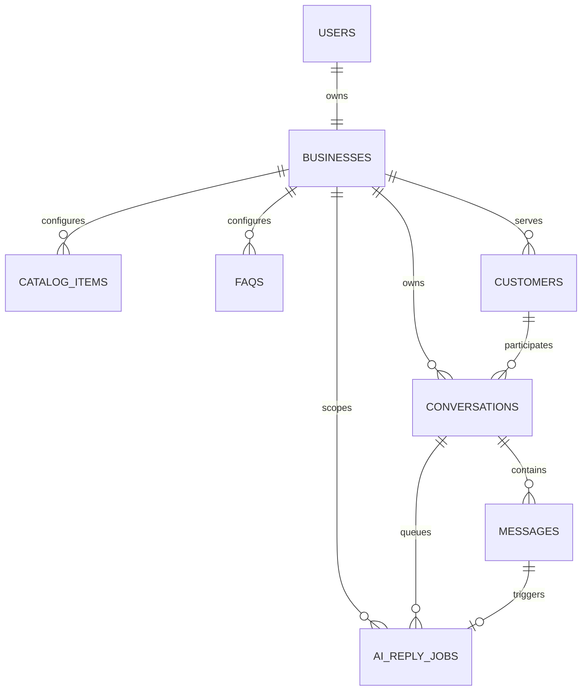

# Database Design

## Status

The backend declares Mongoose models for users, businesses, catalog items, FAQs, customers, conversations, messages, and AI reply jobs. Their default MongoDB collection names are users, businesses, catalogitems, faqs, customers, conversations, messages, and aireplyjobs. The configured application database is whatsapp_sales_assistant; the isolated transaction suite uses whatsapp_sales_assistant_test. A model declaration is not proof that production Atlas currently has every collection or index.

Incoming text webhook processing now creates an eligible AI reply job in the same MongoDB transaction as the new inbound message and conversation control-fence increment, but only when AI_DRAFT_WORKER_ENABLED is true and the conversation responseMode is ai. With the global gate false, the message is still persisted without a job. Gemini draft generation and owner review APIs are implemented. Draft approval does not send a message. The repository has internal send-reservation/completion foundations, but no application route/service that sends an approved AI draft.

Verification status is tracked separately: the project reports 16/16 isolated Atlas transaction/concurrency tests passing and 130/130 regular backend tests passing, including a 40/40 Gemini adapter subset. These results were not rerun for this documentation update. A controlled real Gemini generation last returned HTTP 504 and did not persist a draft. Production collection/index state has not been verified in this documentation task. Types use MongoDB/Mongoose ObjectId, String, Date, Boolean, Number, and embedded objects.

## Collections and fields

### `users`

| Field | Type | Notes |
|---|---|---|
| `_id` | ObjectId | Primary identifier. |
| `name` | String | Required display name. |
| `email` | String | Required, normalized lowercase; unique. |
| `passwordHash` | String | bcrypt hash only. |
| `businessId` | ObjectId | Required reference to the user's one business. |
| `role` | String | `owner` for MVP; allows future operator roles without shipping them now. |
| `createdAt`, `updatedAt` | Date | Timestamps. |

### `businesses`

| Field | Type | Notes |
|---|---|---|
| `_id` | ObjectId | Workspace identifier. |
| `ownerUserId` | ObjectId | Required reference to the sole owner in Version 1.0. |
| `name` | String | Required business display name. |
| `description` | String | Optional factual business description. |
| `industry` | String | Optional category. |
| `contactDetails` | Object | Optional owner-configured public details; current profile API supports phone, email, website, and address. |
| `timezone` | String | Optional IANA timezone for display. |
| `whatsapp` | Object | One `phoneNumberId`, display number, `connectionStatus`, and credential reference/metadata. Current UI states are `not_configured` and `configured_not_verified`; a saved ID alone is not a verified Meta connection. Never plaintext tokens. |
| aiSettings | Object | Schema fields include enabledByDefault, model identifier/configuration, context-message limit, and communication preferences. No secrets. These fields currently have no owner API/UI and are not used by context retrieval or prompt construction; the Gemini model comes from backend configuration. |
| `createdAt`, `updatedAt` | Date | Timestamps. |

MVP relationship: each owner has exactly one business, and each business has exactly one owner. Enforce uniqueness of `businesses.ownerUserId` and of `users.businessId` (required). Adding operators later may change the one-to-many user relationship.

### `catalogItems`

Products and services share this collection, distinguished by `kind`.

| Field | Type | Notes |
|---|---|---|
| `_id` | ObjectId | Identifier. |
| `businessId` | ObjectId | Required business reference. |
| `kind` | String | `product` or `service`. |
| `name` | String | Required. |
| `description` | String | Optional factual details. |
| `priceInPaise` | Number | Optional integer minor units for INR; do not use floating-point monetary arithmetic. |
| `currency` | String | Required and constrained to `INR` by the current model; defaults to `INR`, including when no price is supplied. |
| `availability` | String | Optional owner-maintained availability statement; do not infer live stock from stale text. |
| `isActive` | Boolean | Whether it may be included in AI context. |
| `createdAt`, `updatedAt` | Date | Timestamps. |

Example: `priceInPaise: 45000`, `currency: "INR"` represents ₹450. Display conversion divides the integer paise by 100 and formats it for the selected currency/locale. Persist and calculate using integer minor units only; do not calculate money using floating-point values.

### `faqs`

| Field | Type | Notes |
|---|---|---|
| `_id` | ObjectId | Identifier. |
| `businessId` | ObjectId | Required business reference. |
| `question` | String | Required. |
| `answer` | String | Required owner-provided source of truth. |
| `isActive` | Boolean | Whether it may be included in AI context. |
| `createdAt`, `updatedAt` | Date | Timestamps. |

### `customers`

| Field | Type | Notes |
|---|---|---|
| `_id` | ObjectId | Identifier. |
| `businessId` | ObjectId | Required business reference. |
| `phoneNumber` | String | Required normalized international number, stored as digits without a leading `+`. |
| `profileName` | String | Optional provider profile name, limited to 100 characters. |
| `createdAt`, `updatedAt` | Date | Timestamps. |

The model enforces uniqueness of `{ businessId, phoneNumber }` and validates the normalized number format. Store only the phone number and optional provider display name needed for the MVP.

### `conversations`

| Field | Type | Notes |
|---|---|---|
| `_id` | ObjectId | Identifier. |
| `businessId` | ObjectId | Required business reference. |
| `customerId` | ObjectId | Required reference to a customer in the same business. |
| `status` | String | Required `open` or `closed`; defaults to `open`. |
| `responseMode` | String | `human` or `ai`; defaults to `human`. `ai` permits draft generation only when the worker is enabled; it does not authorize sending. |
| `aiControlVersion` | Number | Internal non-negative integer write fence. Inbound message persistence, draft persistence, approval, and response-mode changes coordinate through conditional/transactional updates on this same document. It is not an owner-facing field. |
| `lastMessageAt` | Date | Optional timestamp used for conversation ordering. |
| `lastMessagePreview` | String | Optional trimmed preview, limited to 280 characters. |
| `createdAt`, `updatedAt` | Date | Timestamps. |

The model enforces one conversation per `{ businessId, customerId }`. Response mode is checked by the draft worker before generation and immediately before draft persistence. Channel and dispatch state are not part of this model.

### `messages`

| Field | Type | Notes |
|---|---|---|
| `_id` | ObjectId | Identifier. |
| `businessId` | ObjectId | Required for tenant-scoped queries and indexes. |
| `conversationId` | ObjectId | Required reference to a conversation in the same business. |
| `customerId` | ObjectId | Required reference to the customer associated with the conversation. |
| `direction` | String | Required `inbound` or `outbound`. |
| `messageType` | String | Required; currently `text` only. |
| `text` | String | Required trimmed text, 1–4096 characters. Subject to an approved retention policy. |
| `providerMessageId` | String | Optional provider ID, trimmed and limited to 256 characters. A partial unique index deduplicates non-empty IDs per business. |
| `status` | String | Required enum: `received`, `sent`, `delivered`, `read`, or `failed`. Verified provider status callbacks update outgoing message status. |
| `timestamp` | Date | Optional provider message timestamp when available; status processing does not overwrite it. |
| `providerStatusAt` | Date | Optional timestamp of the latest accepted provider delivery/read status event, separate from message `timestamp` and Mongoose creation time. |
| `providerErrorCode` | String | Optional failure code, bounded to 64 characters. |
| `providerErrorTitle` | String | Optional provider failure title, bounded to 200 characters. Arbitrary provider error payloads are not stored. |
| `createdAt`, `updatedAt` | Date | Timestamps. |

Outbound records may be created without a provider message ID; the ID is optional and must only be stored when supplied by the provider. No access tokens or other credentials are stored in message documents. Webhook status processing matches only outgoing messages by business and provider ID. Successful statuses advance `sent` → `delivered` → `read`; older events do not regress state. At equal timestamps, the forward successful progression wins, while `failed` can replace `sent` but does not replace `delivered` or `read`. A recorded `failed` status is terminal. Duplicate or non-advancing events do not rewrite the message. Failure code/title are stored only when available and within the field limits. Delivery status is not a retry/send queue and does not automatically alter provider sends.

### aireplyjobs (Mongoose model: AiReplyJob)

This collection stores durable AI draft work and owner-review state. Webhook ingestion creates one job for a newly persisted inbound text message only when the shared AI_DRAFT_WORKER_ENABLED gate is true and the conversation is in AI mode. This creation is in the same transaction as message persistence and the conversation fence increment. Worker processing remains a separate lifecycle.

| Field | Type | Notes |
|---|---|---|
| _id | ObjectId | Job identifier. |
| businessId | ObjectId | Required business scope. |
| conversationId | ObjectId | Required reference to the conversation. |
| inboundMessageId | ObjectId | Required triggering inbound message; unique per business/job. |
| status | String | queued, processing, draft_ready, approved, rejected, sending, sent, send_failed, send_uncertain, failed, or cancelled. Sending-related states are repository foundations; the application-level approved-draft send flow is not implemented. |
| attemptCount | Number | Non-negative safe integer used to fence worker attempts; at most three generation attempts are claimed. |
| nextAttemptAt | Date | Earliest eligible claim/retry time. |
| lockedAt, leaseExpiresAt | Date | Optional generation-worker lease fields. |
| generatedDraft | String | Optional validated draft, up to 4096 characters, for owner review. |
| draftControlVersion | Number | Conversation aiControlVersion captured for the draft. |
| approvedText | String | Owner-approved generated or edited text. Approval does not send. |
| approvedByUserId, approvedAt | ObjectId, Date | Owner approval audit fields. |
| approvalEdited | Boolean | Whether approved text differs from the generated text. |
| rejectedByUserId, rejectedAt, rejectionReason | ObjectId, Date, String | Owner rejection audit data; reason is bounded to 500 characters. |
| sendAttemptId, sendStartedAt, sendLeaseExpiresAt, sendFinishedAt | String, Date | Internal fields for send-reservation foundations. |
| sendOutcome, sendErrorCode, providerStatusCode, providerMessageId, outboundMessageId | String, Number, ObjectId | Internal completion/uncertainty provenance. No credentials or raw provider errors are stored. |
| errorCode | String | Safe generation failure category; no raw provider/database error. |
| createdAt, updatedAt | Date | Timestamps. |

The worker uses atomic claims and attempt/lease-fenced retries, failures, cancellations, and draft completion. It calls Gemini outside transaction callbacks and saves a draft only after the AI-mode/control-fence checks. It does not create an outbound Message or call WhatsApp. The latest controlled real Gemini test returned HTTP 504; it persisted no generatedDraft. Repository-level send reservation, completion, definitive failure, uncertain outcome, and expired-reservation recovery functions exist, but they are not wired to an application-level approved-draft send operation. An uncertain send must not be retried automatically.

## Relationships



All business-owned collections (catalogitems, faqs, customers, conversations, messages, and aireplyjobs) contain businessId.

## Conversation reuse and lifecycle

The current MVP model allows one conversation per customer per business and enforces it with a unique `{ businessId, customerId }` index. A closed conversation therefore remains the customer's conversation; opening a new conversation for the same customer would require a deliberate schema/index and lifecycle change. Incoming text webhook processing creates or reuses this conversation and reopens it for a new message.

## Indexes

These names and key patterns are declared in the Mongoose schemas. They describe application declarations, not proof that a production database currently has the indexes.

- users: users_email_unique, unique { email: 1 }; users_business_id_unique, unique { businessId: 1 }.
- businesses: businesses_owner_user_id_unique, unique { ownerUserId: 1 }.
- catalogitems: catalog_items_business_active_kind, { businessId: 1, isActive: 1, kind: 1 }.
- faqs: faqs_business_active, { businessId: 1, isActive: 1 }.
- customers: customers_business_phone_unique, unique { businessId: 1, phoneNumber: 1 }.
- conversations: conversations_business_customer_unique, unique { businessId: 1, customerId: 1 }; conversations_business_status_last_message, { businessId: 1, status: 1, lastMessageAt: -1 }.
- messages: messages_business_provider_id_unique, unique { businessId: 1, providerMessageId: 1 }, partial filter { providerMessageId: { $type: "string", $gt: "" } }; messages_business_conversation_history, { businessId: 1, conversationId: 1, createdAt: -1 }; messages_business_created_at, { businessId: 1, createdAt: -1 }; messages_business_ai_reply_job_unique, unique { businessId: 1, aiReplyJobId: 1 }, partial filter { aiReplyJobId: { $type: "objectId" } }.
- aireplyjobs: ai_reply_jobs_business_inbound_unique, unique { businessId: 1, inboundMessageId: 1 }; ai_reply_jobs_business_pending, { businessId: 1, status: 1, nextAttemptAt: 1, createdAt: 1 }; ai_reply_jobs_worker_pending, { status: 1, nextAttemptAt: 1, createdAt: 1 }; ai_reply_jobs_business_expired_leases, { businessId: 1, status: 1, leaseExpiresAt: 1 }; ai_reply_jobs_worker_expired_leases, { status: 1, leaseExpiresAt: 1, attemptCount: 1 }; ai_reply_jobs_business_conversation, { businessId: 1, conversationId: 1, createdAt: -1 }; ai_reply_jobs_business_review, { businessId: 1, status: 1, createdAt: -1, _id: -1 }; ai_reply_jobs_one_sending_per_conversation, unique { businessId: 1, conversationId: 1 }, partial filter { status: "sending" }.

The unique job index prevents duplicate queue work for the same inbound message. The partial sending index permits at most one sending job per business/conversation. Message provenance uniqueness prevents duplicate outbound Message records for an AI job. The project reports that the isolated Atlas transaction suite checked/used the relevant indexes and passed 16/16; this does not verify production Atlas indexes. Do not run index synchronization or modify production indexes as part of this documentation.

## Example documents

Illustrative placeholders only; no real customer or configured account is implied.

```json
{
  "_id": "665000000000000000000001",
  "ownerUserId": "665000000000000000000010",
  "name": "Northside Bakery",
  "whatsapp": { "connectionStatus": "not_configured" }
}
```

```json
{
  "businessId": "665000000000000000000001",
  "kind": "product",
  "name": "Chocolate Cake",
  "priceInPaise": 45000,
  "currency": "INR",
  "isActive": true
}
```

```json
{
  "businessId": "665000000000000000000001",
  "phoneNumber": "919876543210",
  "profileName": "Example Customer"
}
```

```json
{
  "businessId": "665000000000000000000001",
  "customerId": "665000000000000000000030",
  "status": "open",
  "lastMessageAt": "2026-10-30T00:00:00.000Z",
  "lastMessagePreview": "Do you have chocolate cake today?"
}
```

```json
{
  "businessId": "665000000000000000000001",
  "conversationId": "665000000000000000000020",
  "customerId": "665000000000000000000030",
  "direction": "inbound",
  "messageType": "text",
  "text": "Do you have chocolate cake today?",
  "providerMessageId": "provider-id-placeholder",
  "status": "delivered",
  "timestamp": "2026-10-30T00:00:00.000Z",
  "providerStatusAt": "2026-10-30T00:00:05.000Z"
}
```

## Security, privacy, and retention

- Derive `businessId` from the authenticated user; never authorize using only a client-supplied ID.
- Before creating/updating a message or conversation, verify the customer, conversation, and business references all belong to the same workspace.
- Restrict customer phone-number access to authorized business users and use database/provider encryption capabilities; any additional application-level encryption design remains to be decided.
- Store only bcrypt password hashes. Never store provider tokens in plaintext or include credentials in examples, logs, or responses. If credentials are stored per business, select an encrypted storage/key-management design first.
- Do not log message bodies by default, authorization headers, tokens, phone numbers, raw webhook bodies, stack traces to clients, or secrets. Log minimal IDs/statuses needed for troubleshooting with access controls.
- Project owner approval is required for message/phone retention periods, deletion behavior, backups, backup expiry, and production data-erasure responsibilities. No retention duration is invented here.
- On approved customer deletion, define how associated conversations/messages are deleted or anonymized and how this interacts with backups and audit needs.
