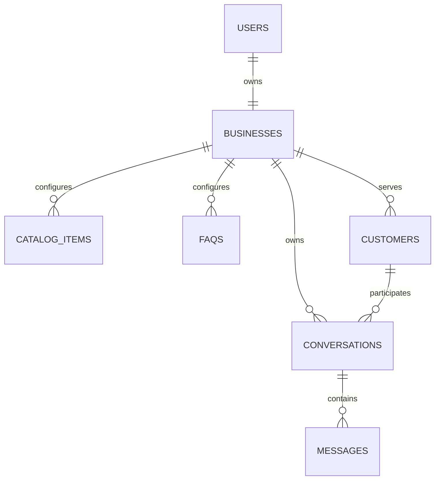

# Database Design

## Status

This document combines implemented Phase 3/4 models with proposed future collections. The backend contains Mongoose models and indexes for `users`, `businesses`, `catalogItems`, and `faqs`, plus a MongoDB connection configured to select `whatsapp_sales_assistant`. The connection code does not establish whether Atlas is reachable in a particular environment. `customers`, `conversations`, and `messages` remain proposed; no models for them are implemented. Field types use MongoDB/Mongoose conventions (`ObjectId`, `String`, `Date`, `Boolean`, `Number`, and embedded objects).

## Collections and fields

### `users`

| Field | Type | Notes |
|---|---|---|
| `_id` | ObjectId | Primary identifier. |
| `name` | String | Required display name. |
| `email` | String | Required, normalized lowercase; unique. |
| `passwordHash` | String | bcrypt hash only. |
| `businessId` | ObjectId | Required reference to the user's one business. |
| `role` | String | `owner` for MVP; allows future operator roles without shipping them now. |
| `createdAt`, `updatedAt` | Date | Timestamps. |

### `businesses`

| Field | Type | Notes |
|---|---|---|
| `_id` | ObjectId | Workspace identifier. |
| `ownerUserId` | ObjectId | Required reference to the sole owner in Version 1.0. |
| `name` | String | Required business display name. |
| `description` | String | Optional factual business description. |
| `industry` | String | Optional category. |
| `contactDetails` | Object | Optional owner-configured public details; current profile API supports phone, email, website, and address. |
| `timezone` | String | Optional IANA timezone for display. |
| `whatsapp` | Object | `phoneNumberId`, display number, connection status, and credential reference/metadata. Never plaintext tokens. |
| `aiSettings` | Object | `enabledByDefault`, model identifier/configuration, context-message limit, and communication preferences. No secrets. |
| `createdAt`, `updatedAt` | Date | Timestamps. |

MVP relationship: each owner has exactly one business, and each business has exactly one owner. Enforce uniqueness of `businesses.ownerUserId` and of `users.businessId` (required). Adding operators later may change the one-to-many user relationship.

### `catalogItems`

Products and services share this collection, distinguished by `kind`.

| Field | Type | Notes |
|---|---|---|
| `_id` | ObjectId | Identifier. |
| `businessId` | ObjectId | Required business reference. |
| `kind` | String | `product` or `service`. |
| `name` | String | Required. |
| `description` | String | Optional factual details. |
| `priceInPaise` | Number | Optional integer minor units for INR; do not use floating-point monetary arithmetic. |
| `currency` | String | Required and constrained to `INR` by the current model; defaults to `INR`, including when no price is supplied. |
| `availability` | String | Optional owner-maintained availability statement; do not infer live stock from stale text. |
| `isActive` | Boolean | Whether it may be included in AI context. |
| `createdAt`, `updatedAt` | Date | Timestamps. |

Example: `priceInPaise: 45000`, `currency: "INR"` represents ₹450. Display conversion divides the integer paise by 100 and formats it for the selected currency/locale. Persist and calculate using integer minor units only; do not calculate money using floating-point values.

### `faqs`

| Field | Type | Notes |
|---|---|---|
| `_id` | ObjectId | Identifier. |
| `businessId` | ObjectId | Required business reference. |
| `question` | String | Required. |
| `answer` | String | Required owner-provided source of truth. |
| `isActive` | Boolean | Whether it may be included in AI context. |
| `createdAt`, `updatedAt` | Date | Timestamps. |

### `customers`

| Field | Type | Notes |
|---|---|---|
| `_id` | ObjectId | Identifier. |
| `businessId` | ObjectId | Required business reference. |
| `whatsappId` | String | Provider/customer identity scoped to business; required. |
| `displayName` | String | Optional provider profile name. |
| `phoneNumber` | String | Optional, access restricted; retention/deletion policy open. |
| `createdAt`, `updatedAt` | Date | Timestamps. |

### `conversations`

| Field | Type | Notes |
|---|---|---|
| `_id` | ObjectId | Identifier. |
| `businessId` | ObjectId | Required business reference. |
| `customerId` | ObjectId | Required reference to a customer in the same business. |
| `channel` | String | `whatsapp` in this scope. |
| `mode` | String | `ai` or `human`. |
| `takeoverRequested` | Boolean | Defaults false; prevents new AI dispatch while takeover is being finalized. |
| `controlVersion` | Number | Integer fence incremented on mode/takeover changes to invalidate stale generations. |
| `activeDispatch` | Object/null | AI send claim identifier, state, and start time; used to coordinate with takeover and resolve stale sends. |
| `status` | String | `open` or `closed`; lifecycle policy below. |
| `lastMessageAt` | Date | Inbox sorting. |
| `createdAt`, `updatedAt` | Date | Timestamps. |

### `messages`

| Field | Type | Notes |
|---|---|---|
| `_id` | ObjectId | Identifier. |
| `businessId` | ObjectId | Required for tenant-scoped queries and indexes. |
| `conversationId` | ObjectId | Required reference to a conversation in the same business. |
| `direction` | String | `inbound` or `outbound`. |
| `senderType` | String | `customer`, `ai`, or `owner`; distinguishes AI-generated and owner-generated replies. |
| `text` | String | Message text, subject to retention policy. |
| `providerMessageId` | String | Provider identifier when available; used for webhook idempotency and status matching. |
| `deliveryStatus` | String | `received`, `pending`, `sending`, `sent`, `delivered`, `read`, `failed`, or `unknown` as applicable. `sent` does not mean delivered. |
| `processingStatus` | String | For inbound AI work: `not_applicable`, `pending`, `generating`, `ready_to_send`, `sending`, `completed`, `failed`, or `unknown`. |
| `retryCount` | Number | Nonnegative integer; automatic Gemini retry limit proposed as two retries after initial attempt. |
| `receivedAt` | Date | When inbound event was persisted. |
| `processedAt` | Date | When processing reached a terminal state. |
| `lastErrorCode` | String | Sanitized internal/provider category; no raw secrets or stack traces. |
| `errorSummary` | String | Optional sanitized owner-visible summary. |
| `processingId` | String | Optional identifier for atomic claim/fencing of an AI processing attempt. |
| `createdAt`, `updatedAt` | Date | Timestamps. |

`processingStatus` and retry fields are primarily meaningful on the inbound trigger message. Outbound AI/owner messages track their own delivery status. Ambiguous send outcomes use `unknown` and are not automatically resent.

## Relationships



All records owned by a business (`catalogItems`, `faqs`, `customers`, `conversations`, and `messages`) contain `businessId`. The owner/business relationship is one-to-one in the MVP; future operators are not part of current scope.

## Conversation reuse and lifecycle

For an inbound message, find an `open` WhatsApp conversation for the same `{ businessId, customerId, channel }` and reuse it. If none exists, create one. Closing a conversation is an explicit owner action or a later agreed lifecycle rule; the next inbound after closure creates a new conversation. Do not add an unconditional unique index for open conversations. Concurrent webhook creation can briefly race; handle duplicate candidates by re-querying and selecting one canonical open conversation, or use a carefully scoped partial unique index only if lifecycle semantics and MongoDB support are validated.

## Indexes

The following indexes are declared in the current Mongoose models:

- `users`: unique `{ email: 1 }` and unique `{ businessId: 1 }`.
- `businesses`: unique `{ ownerUserId: 1 }`.
- `catalogItems`: `{ businessId: 1, isActive: 1, kind: 1 }`.
- `faqs`: `{ businessId: 1, isActive: 1 }`.

The remaining indexes below are proposed for the future customer, conversation, and message models; they are not implemented:
- `customers`: unique compound `{ businessId: 1, whatsappId: 1 }`.
- `conversations`: `{ businessId: 1, customerId: 1, channel: 1, status: 1 }` for lookup; `{ businessId: 1, lastMessageAt: -1 }` for inbox sorting. No unconditional unique open-conversation index.
- `messages`: unique partial compound `{ businessId: 1, providerMessageId: 1 }` when provider ID exists; `{ businessId: 1, conversationId: 1, createdAt: -1 }` for pagination; `{ processingStatus: 1, updatedAt: 1 }` for bounded recovery scans if query plans justify it.

When the message model is implemented, a unique business-scoped provider ID index can make duplicate webhook insertion fail safely; on duplicate-key conflict, load the existing message and acknowledge the event without repeating downstream work. Provider status events should match the existing outbound provider ID and apply idempotently. Validate proposed index definitions against actual MongoDB/Mongoose queries before implementation.

## Example documents

Illustrative placeholders only; no real customer or configured account is implied.

```json
{
  "_id": "665000000000000000000001",
  "ownerUserId": "665000000000000000000010",
  "name": "Northside Bakery",
  "aiSettings": { "enabledByDefault": true, "contextMessageLimit": 12 },
  "whatsapp": { "connectionStatus": "not_configured" }
}
```

```json
{
  "businessId": "665000000000000000000001",
  "kind": "product",
  "name": "Chocolate Cake",
  "priceInPaise": 45000,
  "currency": "INR",
  "isActive": true
}
```

```json
{
  "businessId": "665000000000000000000001",
  "conversationId": "665000000000000000000020",
  "direction": "inbound",
  "senderType": "customer",
  "text": "Do you have chocolate cake today?",
  "providerMessageId": "provider-id-placeholder",
  "deliveryStatus": "received",
  "processingStatus": "pending",
  "retryCount": 0,
  "receivedAt": "2026-10-30T00:00:00.000Z"
}
```

## Security, privacy, and retention

- Derive `businessId` from the authenticated user; never authorize using only a client-supplied ID.
- Before creating/updating a message or conversation, verify the customer, conversation, and business references all belong to the same workspace.
- Restrict customer phone-number access to authorized business users and use database/provider encryption capabilities; any additional application-level encryption design remains to be decided.
- Store only bcrypt password hashes. Never store provider tokens in plaintext or include credentials in examples, logs, or responses. If credentials are stored per business, select an encrypted storage/key-management design first.
- Do not log message bodies by default, authorization headers, tokens, phone numbers, raw webhook bodies, stack traces to clients, or secrets. Log minimal IDs/statuses needed for troubleshooting with access controls.
- Project owner approval is required for message/phone retention periods, deletion behavior, backups, backup expiry, and production data-erasure responsibilities. No retention duration is invented here.
- On approved customer deletion, define how associated conversations/messages are deleted or anonymized and how this interacts with backups and audit needs.
